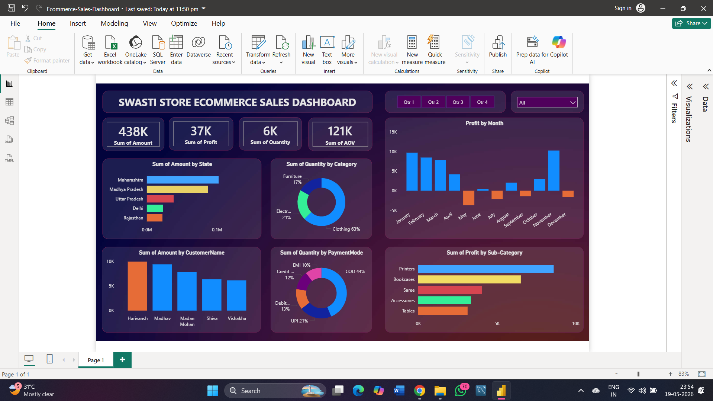
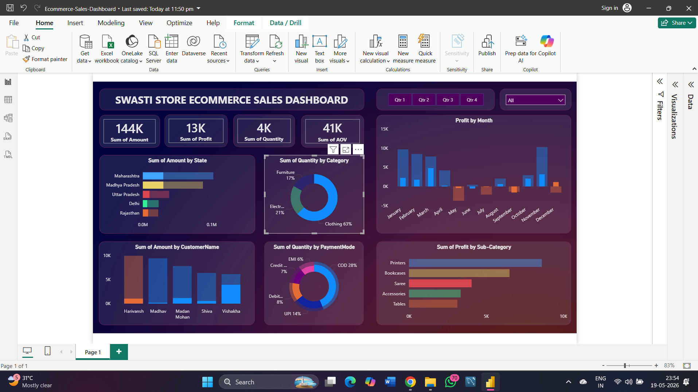
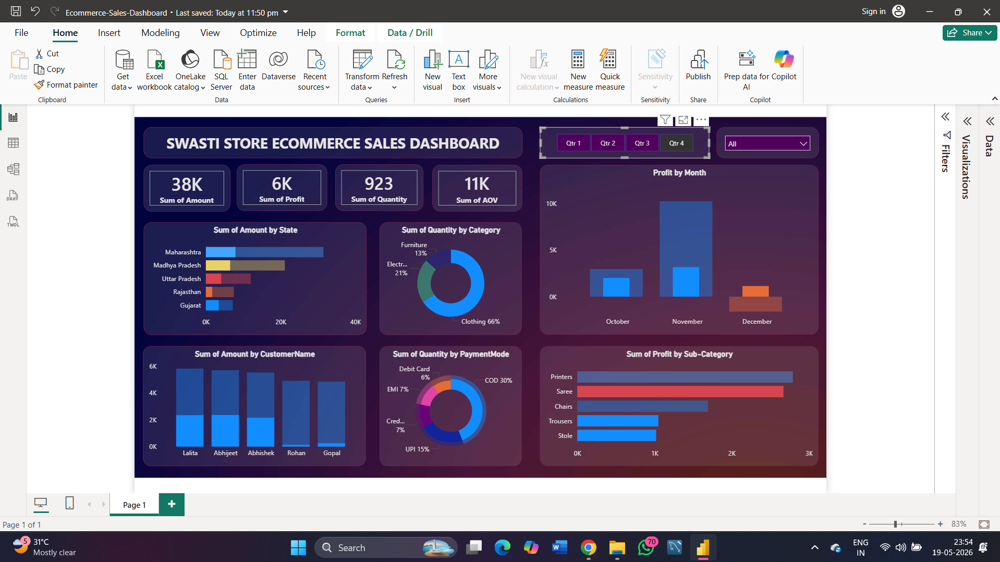

# 🛒 Ecommerce Sales Dashboard – Power BI

## 📌 Project Overview

This project is an interactive **Ecommerce Sales Dashboard** built using **Power BI** to analyze sales performance, customer behavior, profit trends, and payment insights.

The dashboard provides meaningful business insights through interactive visualizations and KPI tracking. It helps identify high-performing states, profitable months, preferred payment methods, and top-selling product categories.

This project demonstrates skills in **data visualization, dashboard design, business intelligence, data cleaning, and DAX calculations** using real-world ecommerce sales data.

---

# 📊 Dashboard Preview

## 🔹 Main Dashboard

## 🔹 Catagory Analysis

## 🔹 Quarterly Analysis

---

# 🚀 Features

* ✅ Interactive Filters & Slicers
* ✅ KPI Metrics Visualization
* ✅ State-wise Sales Analysis
* ✅ Monthly Profit Analysis
* ✅ Customer-wise Sales Insights
* ✅ Category & Sub-Category Analysis
* ✅ Payment Mode Distribution

---

# 📈 Key Insights

* 📌 Maharashtra generated the highest sales amount
* 📌 Clothing category contributed the highest quantity sold
* 📌 COD was the most preferred payment method
* 📌 December recorded the highest monthly profit

---

# 🛠️ Tools & Technologies Used

* Power BI
* Power Query
* DAX
* Data Visualization
* Excel / CSV Dataset

---

# 📂 Files Included

* 📄 Power BI Dashboard (.pbix)
* 📄 Dataset File
* 📄 Dashboard Screenshots
* 📄 Project Documentation

---

# 🎯 Learning Outcomes

Through this project, I improved my skills in:

* Dashboard Design
* Data Cleaning
* Data Modeling
* DAX Calculations
* Business Intelligence
* Interactive Reporting

---

# 👩‍💻 Author

**HARSH RAJ**

